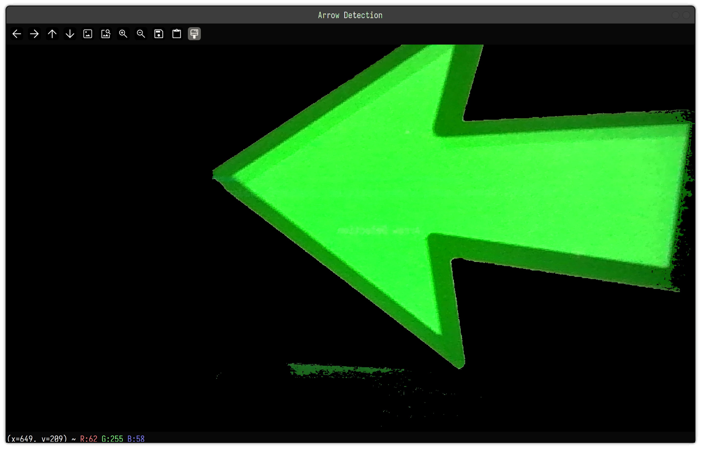

# Detect-color-signs
A improved version to showcase specific needs can be fulfilled using computer vision.

Used opencv & python to do somehing specific needs. In this case detecting any green arrows(sorry cant detect red flags) in the frame.
In this script, lower_green and upper_green define the range of green we are looking for. The values [50, 100, 100] and [70, 255, 255] are a general range for green, but depending on the specific shade of green you are trying to detect and your lighting conditions, you may need to adjust these values.  

