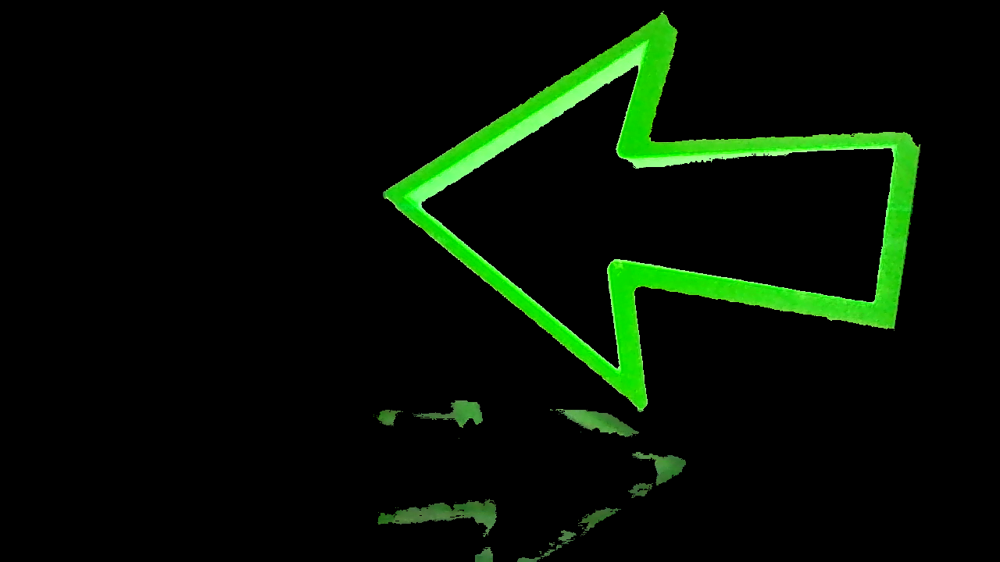
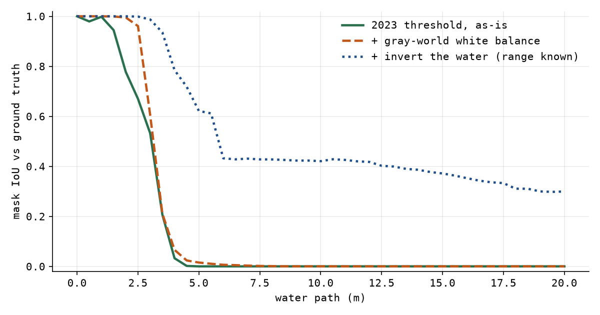
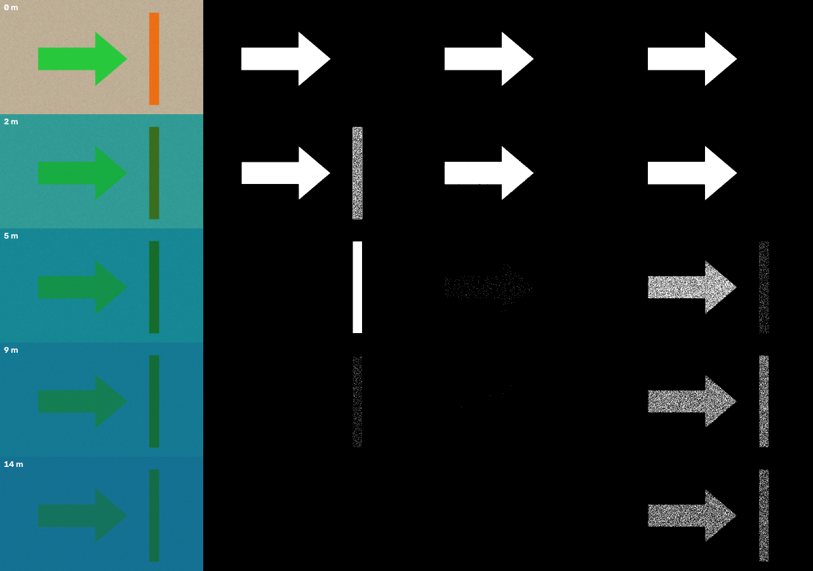
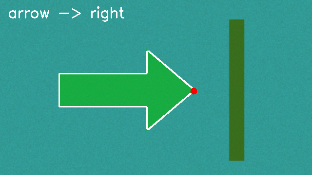
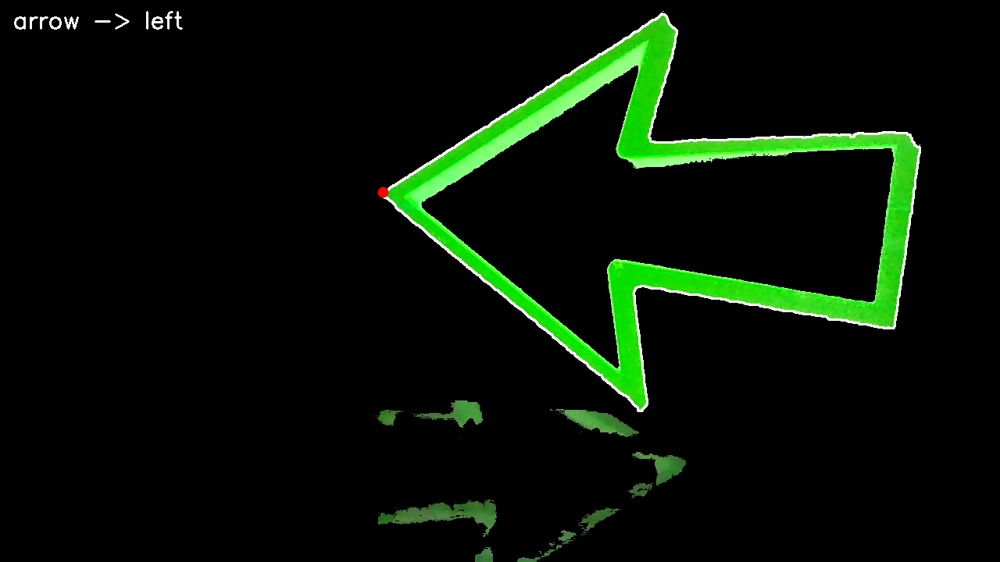

# green-at-depth

**How deep can you take a colour threshold before the water lies to it?**

In November 2023 I wrote a 40-line OpenCV script that found green arrows by
asking every pixel one question: *is your hue between 50 and 70?* It worked
on my desk. It was meant for an underwater robot.



*November 2023, on the desk. It was called "arrow detection". It detected green.*

This repo does two things to that script: it takes it for a swim, and then
it finishes it.



## The problem with water

Water is a colour filter that gets thicker the further you look through it.
Red light is absorbed about twenty times faster than blue, and the water
also glows back at the camera with its own blue-green haze. A pixel underwater is

```
I = J · e^(−k·d)  +  B · (1 − e^(−k·d))
    what's there      what the water adds
```

`J` is the object's true colour, `B` the veiling light, `d` the metres of
water between lens and object, and `k` a per-channel attenuation coefficient.
Here `k` is pure-water absorption (Pope & Fry, 1997) scaled ×4 to stand in for
a real pool. That scale is a knob, not a measurement.

## What happened

A synthetic RoboSub-style card (green arrow, orange gate post, sandy floor)
sinks in 0.5 m steps. The script's original HSV range is scored against the
known ground-truth mask:



*Columns: what the camera sees · 2023 threshold · gray-world first · water inverted first.*

| water path | as-is | gray-world | invert the water |
|---:|---:|---:|---:|
| 0 m | 1.000 | 1.000 | 1.000 |
| 2 m | 0.777 | 0.995 | 1.000 |
| 3 m | 0.532 | 0.605 | 0.987 |
| 5 m | 0.000 | 0.015 | 0.621 |
| 10 m | 0.000 | 0.000 | 0.421 |
| **IoU < 0.5 at** | **3.5 m** | **3.5 m** | **6.0 m** |

Three things I didn't expect:

1. **The first failure is a hallucination, not a blindness.** At 2 m the
   *orange* gate post turns green enough to pass, so the detector reports two
   arrows. A detector that sees nothing tells you; one that sees the wrong thing
   points you at a post.
2. **White balance fixes the hallucination but not the drowning.** Gray-world
   removes the false gate but loses the real arrow at the same depth: the haze
   flattens saturation below the threshold's floor of 100.
3. **Knowing the physics buys depth until the noise collects the bill.**
   With the range known (a DVL or sonar gives you this on a real vehicle) you
   can divide the water back out. That works until the red channel is so dim
   that dividing by it mostly amplifies sensor noise. At that point the gate
   post comes back as speckle.

Water decides when the threshold dies. The engineering only gets to move the depth.

## Finishing the 2023 job

[`depthsight/detect.py`](depthsight/detect.py) is the script I meant to write:
it finds *an arrow*, not just green, and says which way it points.

- **Shape is a second opinion that colour can't fake.** An arrow is solid but
  notched (its area is 55–92 % of its convex hull), while the gate post is a
  rectangle at ~100 %. That one check removes the 2 m hallucination without any
  white balance.
- **The head is the wide end.** My first attempt took the point farthest from the
  centroid as the tip and got every arrow backwards: the head's bulk drags the
  centroid forward, so the tail corners win. v2 looks along the shape's long axis
  and calls the end that's wider across the head.
- `--gray-world` and `--range-m` bring in the two fixes from the depth sweep.




*Top: 2 m of water, post correctly ignored. Bottom: the original 2023 frame,
rerun. Arrow found, pointing left, reflections ignored.*

## Run it

```bash
python -m venv .venv && . .venv/bin/activate
pip install -r requirements.txt
python -m depthsight.run                              # the depth sweep: table + assets/*.png
python -m depthsight.detect                           # webcam, live
python -m depthsight.detect --image some.png --gray-world
pytest -q                                             # directions, the post, the 2023 frame
```

Deterministic: fixed seeds, no camera needed for anything but the live mode.

## Layout

```
origin/detect.py       the 2023 webcam script, untouched
README-2023.md         its README, with the original screenshots
depthsight/water.py    image-formation model, gray-world, inversion
depthsight/scene.py    synthetic test card with exact ground truth
depthsight/run.py      the sweep, the plot, the filmstrip
depthsight/detect.py   the finished detector
tests/                 what it must keep getting right
```

## Where this went

The same lesson, learned in real pools on the BRACU Duburi AUVs, is why later
vision work moved from colour rules to learned detectors trained on underwater
data.
